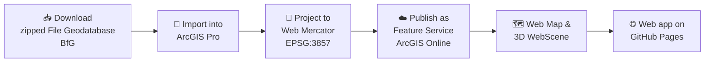

<div align="center">

# 🌊 Überflutungsflächen nach Risiko in NRW
### Flood Risk Zones in North Rhine-Westphalia (Germany) – GIS Web Mapping Project

[](https://mohamedaitabdelmalik.github.io/Uberflutungsflachen-nach-Risiko-in-NRW-Deutschland/)
[](https://ucd-cpe.maps.arcgis.com/home/item.html?id=f0ce21dbb53f4453a01cd4cf3e11ee0e)
[](https://www.arcgis.com/home/webscene/viewer.html?webscene=8f054c543a544eeca11d97a5714b728c&viewpoint=cam:816555.3458868,6700580.08227863,34837.195,102100;271.771,59.2&ui=min)


</div>

---

## 📑 Table of Contents

- [Overview](#-overview)
- [Features](#-features)
- [Risk Classes](#-risk-classes)
- [Preview](#-preview)
- [Data](#-data)
- [Workflow](#-workflow)
- [Tech Stack](#-tech-stack)
- [Repository Structure](#-repository-structure)
- [Run Locally](#-run-locally)
- [Deploy on GitHub Pages](#-deploy-on-github-pages)
- [Deutsche Zusammenfassung](#-deutsche-zusammenfassung)
- [Data Source & Attribution](#-data-source--attribution)
- [Author](#-author)

---

## 🎯 Overview

This project presents **flood risk zones across the state of North Rhine-Westphalia (NRW)** through an interactive GIS web mapping application.

The analysis was developed in **ArcGIS Pro**, where the *German Flood Risk Zones* dataset from the **Bundesanstalt für Gewässerkunde (BfG)** was processed. The data was downloaded as a File Geodatabase, imported into ArcGIS Pro, projected to **Web Mercator (WGS 84 – EPSG:3857)** and published as a **Feature Service on ArcGIS Online**.

An interactive web mapping application was then built and deployed with **GitHub Pages**, so anyone can explore flood risk across the entire region in 2D and 3D.

The dataset supports the **EU Floods Directive (Flood Risk Management Directive)** through the national water reporting portal **WasserBLIcK**.

> 🌍 **Live web map:** https://mohamed-aitabdelmalik.github.io/Uberflutungsflachen-nach-Risiko-in-NRW-Deutschland-/
> 🗺️ **ArcGIS Online item:** https://ucd-cpe.maps.arcgis.com/home/item.html?id=f0ce21dbb53f4453a01cd4cf3e11ee0e

---

## ✨ Features

| | Feature | Description |
|---|---|---|
| 🗺️ | **Interactive 2D map** | ArcGIS web map with pop-ups, address search, basemap gallery, compass and scale bar |
| 🎛️ | **Interactive legend** | Built live from the web map's layers: toggle layers, change opacity, zoom to a layer, highlight single risk classes |
| 🚦 | **Risk class focus** | One click highlights *Hohes*, *Mittleres* or *Geringes Risiko* and fades the rest |
| 🧭 | **Quick navigation** | Jump to Köln, Düsseldorf, Bonn, Dortmund, Duisburg, Euskirchen or all of NRW |
| 🧊 | **3D scene** | ArcGIS WebScene with camera presets (default, top-down, low angle, north-up) |
| 🖼️ | **Layout gallery** | Cartographic layouts with a full-screen image viewer |
| 🌗 | **Dark / light theme** | The map theme follows the page theme |
| 📱 | **Responsive design** | Works on desktop, tablet and phone; includes a QR code to the author's portfolio |

---

## 🚦 Risk Classes

| Class | Meaning | Colour on map |
|---|---|---|
| **Hohes Risiko** | High risk | 🟧 red-orange |
| **Mittleres Risiko** | Medium risk | 🟨 amber |
| **Geringes Risiko** | Low risk | 🟩 olive-yellow |

---

## 🖼️ Preview

### 2D map layout


### High-resolution layout


### 🧊 3D scene

GitHub does not display embedded iframes in a README, so open the scene here:
**[▶ Launch the 3D scene](https://www.arcgis.com/home/webscene/viewer.html?webscene=8f054c543a544eeca11d97a5714b728c&viewpoint=cam:816555.3458868,6700580.08227863,34837.195,102100;271.771,59.2&ui=min)**

To embed it in your own page:

```html
<iframe width="1080" height="720" frameborder="0" scrolling="no" allowfullscreen
  src="https://www.arcgis.com/home/webscene/viewer.html?webscene=8f054c543a544eeca11d97a5714b728c&viewpoint=cam:816555.3458868,6700580.08227863,34837.195,102100;271.771,59.2&ui=min">
</iframe>
```

---

## 📦 Data

| | |
|---|---|
| **Content** | Feature Service & Web Map with flood risk zones in North Rhine-Westphalia, Germany |
| **Provider** | Bundesanstalt für Gewässerkunde (BfG), on behalf of the water management authorities |
| **Portal** | National reporting portal [WasserBLIcK](https://www.gewaesser-bewertung.de/) |
| **Basis** | Nationwide, homogenized data coordinated with the Länderarbeitsgemeinschaft Wasser (LAWA) |
| **Reference** | EU Floods Directive, 2nd cycle (2016–2021); BfG metadata catalogue, last accessed 27 Oct 2025 |
| **Coordinate system** | Web Mercator (WGS 84), EPSG:3857 |
| **Last edited** | 2024 |

---

## 🔄 Workflow



1. **Download** the flood risk zones as a zipped File Geodatabase
2. **Import** into ArcGIS Pro
3. **Project** to Web Mercator WGS 84 (EPSG:3857)
4. **Host** as a Feature Service on ArcGIS Online
5. **Build** the 2D web map and the 3D web scene
6. **Deploy** the interactive web application on GitHub Pages

---

## 🛠️ Tech Stack

- **GIS:** ArcGIS Pro · ArcGIS Online (Feature Service, Web Map, Web Scene)
- **Web:** HTML5 · CSS3 · JavaScript (vanilla)
- **Mapping:** [ArcGIS Maps SDK for JavaScript 5.0](https://developers.arcgis.com/javascript/latest/) (map components)
- **Hosting:** GitHub Pages
- **Supported by:** Esri

---

## 📁 Repository Structure

```text
.
├── index.html        # Interactive web application (2D map, 3D scene, gallery)
├── Layout.jpg        # Map layout
├── La444out.jpg      # Visualization layout
├── profile.jpg       # Author photo (optional)
├── cv.pdf            # Author CV (optional)
└── README.md
```

---

## 💻 Run Locally

The ArcGIS scripts need `http://`, so don't open `index.html` by double-clicking it. Start a small local server instead:

```bash
git clone https://github.com/mohamed-aitabdelmalik/Uberflutungsflachen-nach-Risiko-in-NRW-Deutschland-.git
cd Uberflutungsflachen-nach-Risiko-in-NRW-Deutschland-

# Python 3
python -m http.server 8000
```

Then open <http://localhost:8000>.

> ⚠️ The ArcGIS Online web map and web scene must be shared as **Public**, otherwise visitors will see a blank map or a sign-in prompt.

---

## 🚀 Deploy on GitHub Pages

1. Push the files to the repository root.
2. Go to **Settings → Pages**.
3. Under *Build and deployment*, choose **Deploy from a branch**, select `main` and `/ (root)`, then **Save**.
4. After a minute the site is live at `https://<user>.github.io/<repository>/`.

---

## 🇩🇪 Deutsche Zusammenfassung

**Überflutungsrisikozonen Deutschland – Nordrhein-Westfalen**

Dieses Projekt stellt die Überflutungsrisikozonen in Nordrhein-Westfalen als interaktive GIS-Webkarte dar.

- **Inhalt:** Feature Service & Web Map mit Überflutungsrisikozonen in Nordrhein-Westfalen, Deutschland.
- **Verwaltung:** Die Daten werden von der Bundesanstalt für Gewässerkunde (BfG) im Auftrag der Wasserwirtschaftsverwaltungen gepflegt und über das nationale Berichtsportal WasserBLIcK bereitgestellt.
- **Datenbasis:** Nationale, flächendeckend homogenisierte Daten, abgestimmt mit der Länderarbeitsgemeinschaft Wasser (LAWA).
- **Quelle:** Hochwasserrisikomanagement-Richtlinie, 2. Zyklus (2016–2021), BfG-Metadatenkatalog, zuletzt abgerufen am 27.10.2025.
- **Verarbeitung:**
  1. Download als gezippte File-Geodatabase
  2. Import in ArcGIS Pro
  3. Projektion ins WebMercator-WGS84-Koordinatensystem (EPSG:3857)
  4. Hosting als Feature Service auf ArcGIS Online
- **Datenstand:** Letzte Bearbeitung 2024

**Risikoklassen:** Hohes Risiko · Mittleres Risiko · Geringes Risiko

---

## 📚 Data Source & Attribution

- **Data:** *Flood Risk Zones Germany* – Bundesanstalt für Gewässerkunde (BfG), via WasserBLIcK
- **Directive:** EU Floods Directive (Hochwasserrisikomanagement-Richtlinie), 2nd cycle 2016–2021
- **Supported by:** Esri Germany

This is an educational GIS portfolio project and **not an official hazard map**. For decisions about properties, planning or emergency response, consult the official flood hazard maps of the responsible authorities. Please check the BfG terms of use before reusing the data.

---

## 👤 Author

**Mohamed Ait Abdelmalik** – Geomatics Specialist · GIS Analyst (Geosciences & Environment)
📍 Casablanca, Morocco

[](https://mohamedaitabdelmalik.netlify.app/)
[](https://www.linkedin.com/in/mohamed-ait-abdelmalik-a7b468195/)
[](https://github.com/mohamedaitabdelmalik)
[](https://x.com/MoAitAbdelmalik)
[](https://www.researchgate.net/profile/Mohamed-Ait-Abdelmalik)
[](mailto:mohamed.aitabdelmalik@gmail.com)

<div align="center">

⭐ If you find this project useful, please give it a star!

</div>
